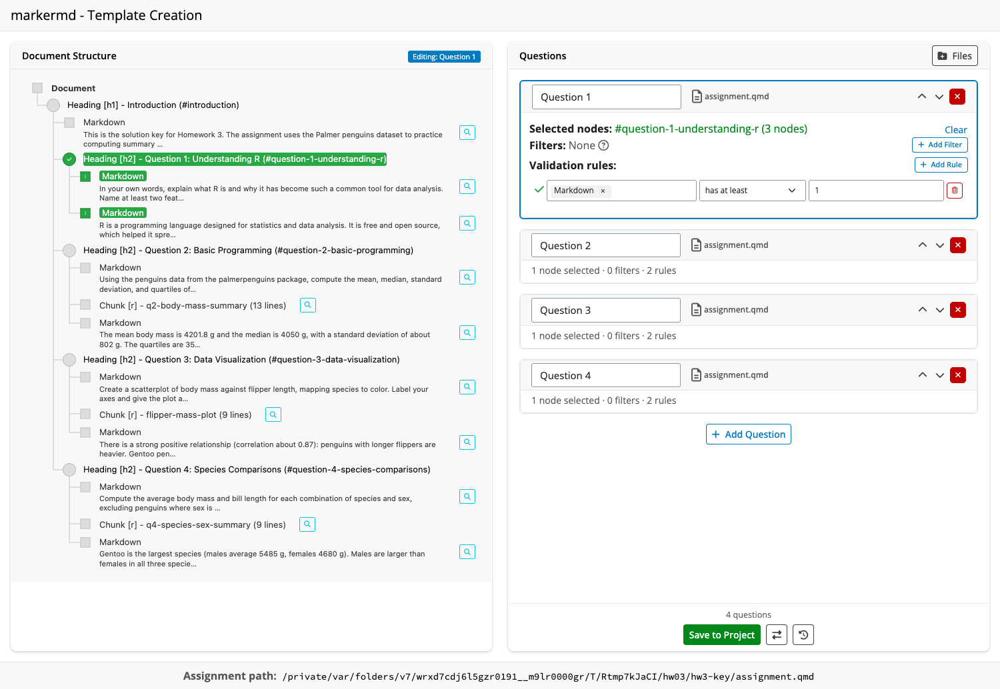
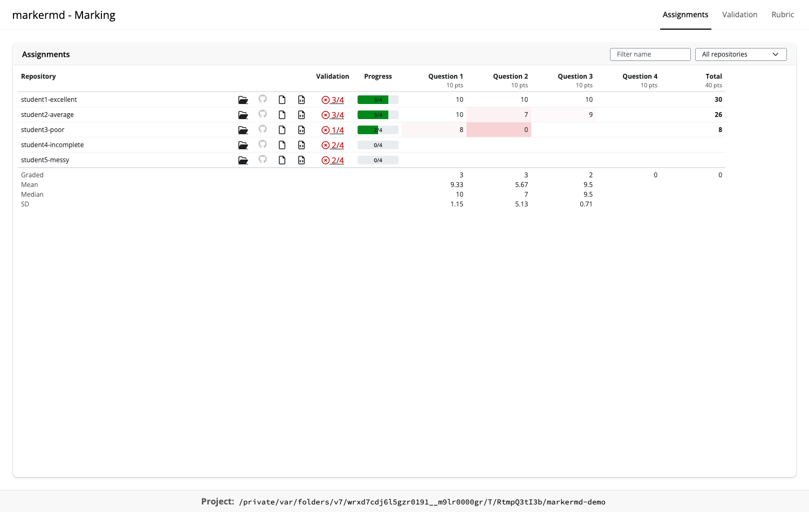
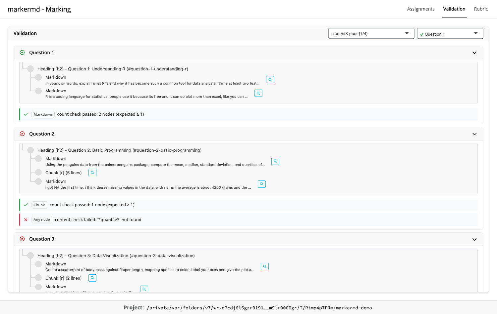
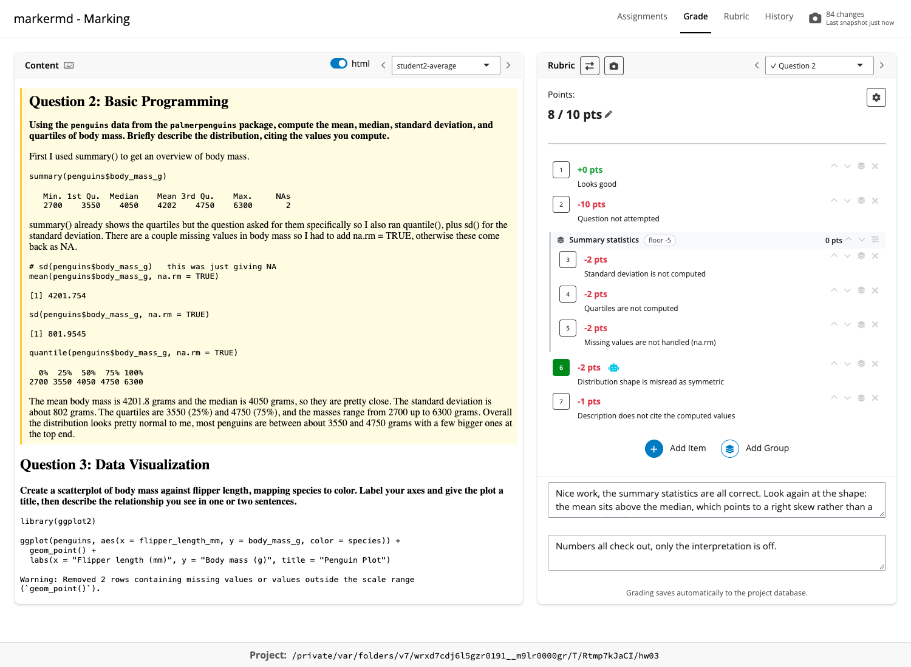
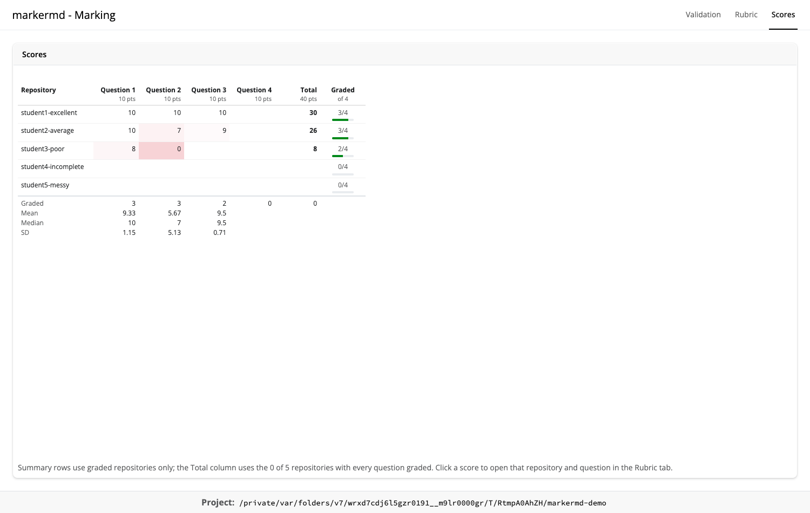

# markermd

<!-- badges: start -->
[](https://lifecycle.r-lib.org/articles/stages.html#experimental)

[](https://github.com/rundel/markermd/actions/workflows/R-CMD-check.yaml)
[](https://rundel.github.io/markermd/)
<!-- badges: end -->

markermd is a Shiny-based grading environment for assignments submitted as git repositories containing Quarto (`.qmd`) or R Markdown (`.Rmd`) documents, such as the classroom layouts produced by [ghclass](https://rundel.github.io/ghclass/)'s `org_grade_assignment()`. Each submission is parsed into a document tree (via [q2r](https://github.com/rundel/q2r)), validated against the structural requirements of the assignment, and graded question by question with a fast, hotkey-driven rubric interface. Everything (the template, the rubric, and all recorded grading) lives in a per-project SQLite database.

The package is built around two apps:

- `template()` authors a grading template: which document sections are the questions, and what structural rules each answer must satisfy.
- `mark()` grades a collection of student repositories against that template with per-question rubrics.

Around the apps, a set of helper functions (`validate_project()`, `parse_project()`, `template_import()` / `template_export()`, `rubric_import()` / `rubric_export()`, `marks_import()` / `marks_export()` / `marks_set()`, `export_marks()`) makes the entire workflow scriptable, and bundled agent skills (for Claude Code and Codex) can scaffold the template and rubric, repair submissions the strict parser rejects, or apply the rubric across all submissions as a first pass for human review.

## Experimental status

This package is experimental: APIs may change significantly and some features are incomplete.

This project is also an ongoing experiment in "vibe" coding with Claude Code. Not all implementation details have been thoroughly evaluated and there is a lot of wonkiness throughout the codebase.

## Installation

You can install the development version of markermd from GitHub:

```r
# Install from GitHub
# install.packages("pak")
pak::pak("rundel/markermd")

# Or using remotes
remotes::install_github("rundel/markermd")
```

### Dependencies

markermd relies on [q2r](https://github.com/rundel/q2r) for parsing Quarto documents. q2r wraps the Quarto parser via Rust, so a Rust toolchain (`rustc >= 1.85`) is required to install it:

```r
remotes::install_github("rundel/q2r")
```

## Quick start

A markermd project is a directory containing the student repositories, and optionally a solution (key) repository and rendered reports:

```
hw01/
├── repos/
│   ├── student1-hw01/
│   │   └── assignment.qmd
│   ├── student2-hw01/
│   └── ...
├── html/              # rendered reports, shown while grading
└── hw01-key/          # solution repository (optional)
```

```r
library(markermd)

# One-time setup: writes .markermd/config.yml, creates the grading
# database, installs the bundled agent skills, and writes CLAUDE.md /
# AGENTS.md project instructions for them
init_project("hw01")

# Author the grading template (questions + validation rules)
template("hw01")

# Grade the student repositories
mark("hw01")
```

`init_project()` detects the key repository and artifact directories, records everything in `hw01/.markermd/config.yml`, and creates the SQLite database that stores the template, rubric, and all grading. `project_sitrep()` prints an overview of a project's configuration at any point.

## Template creation with `template()`

The template app loads an assignment (a project's key repository, a single `.qmd`/`.Rmd` file or directory, a saved template, or a GitHub `<owner>/<repo>`) and displays its structure as an interactive tree. Headings are the selectable units: selecting one maps the document section beneath it to a question. Each question then gets validation rules (counts of chunks, markdown blocks, or other node types; content checks; name checks) along with optional filters that narrow which nodes the rules see. Point values are not part of the template; each question's total is set with its rubric while grading.



When the app is opened on an initialized project, saving writes the template directly into the project database, ready for grading.

## Grading with `mark()`

`mark()` opens an initialized project and sources everything from it: the student repositories, the stored template, the grading database, and each repository's rendered reports.

### Assignments

The app opens on the Assignments tab, a progress dashboard with one row per repository: links to its folder, GitHub repository, rendered report and source, its validation status, and its grading progress. The table filters by name and by status (failed validation, incomplete, complete), and clicking a repository's validation marker opens it in the Validation tab.



### Validation

The Validation tab checks the selected repository against the template's rules, so structural problems (missing sections, missing chunks, absent content) are visible before any grading starts. Its repository selector stays in step with the rest of the app.



### Rubric

The Rubric tab is where grading happens. The left pane shows the student's rendered report or source; the right pane shows the current question's rubric. Items toggle by click or number-key hotkey (the first ten items of a question get the keys 1-9 and 0; there is no limit on items, and any beyond the tenth toggle by click), and the score follows from the question's scoring setup (additive or deduction mode, with optional clamping between zero and the question total; clicking the score display edits the total, and the gear popover holds the mode and bounds). Below the items are two comment boxes: a public, student-facing comment (which also marks the question as graded) and private notes that are never shared with students. Every action autosaves to the project database.



Rubric items can be added, edited, and reordered while grading, and the rubric pane's menu offers YAML import and export for editing the rubric outside the app.

### Scores

The Scores tab shows the grading so far: every repository's score per question and its total, computed from the rubric selections exactly as `export_scores()` would, with summary rows beneath (how many repositories are graded, then the mean, median and standard deviation per question and for the total). The table sorts by any column with the summary rows staying put, pages for large classes, and updates as grading proceeds. Clicking a score opens that repository and question in the Rubric tab.



## Scripting the workflow

Everything the apps do is also available headlessly:

```r
# Check every student repository against the stored template
validate_project("hw01")

# Templates, rubrics, and recorded marks round trip between the
# project database and editable YAML files
template_export("hw01-template.yaml", project = "hw01")
rubric_import("hw01-rubric.yaml", project = "hw01")
marks_export("hw01-marks.yaml", project = "hw01")

# Record marks for a single repository/question pair
marks_set("student1-hw01", "Question 2",
  items = "Looks good",
  private_comment = "Quartiles and summary statistics all present.",
  project = "hw01"
)
```

The YAML formats are validated against bundled JSON Schemas (see `system.file("schema", package = "markermd")`) and are deliberately simple enough for LLM tools to author. Marks imports are conservative by default: repository/question pairs that already have grading activity are skipped unless explicitly overwritten.

## Exporting results

When grading is complete, `export_marks()` writes the final hand-off artifacts from the project database (or run `export_scores()` and `export_comments()` individually):

```r
export_marks("hw01")
```

- `export_scores()` writes `scores.csv` to the project root: one row per repository, one column per question, plus a `total` column. Scores are recomputed exactly as `mark()` displays them, passing each question's selected rubric item points through its grading mode and bounds. Ungraded repository/question pairs export as `NA`, and a repository's total stays `NA` until all of its questions are graded.
- `export_comments()` writes each repository's student-facing feedback to `comments/<repo>.md` (or the project's configured comments directory). Each graded question appears as a heading, in template order, followed by a bulleted list of its selected rubric item descriptions and public comment. Private notes are never exported, and a repository with no public feedback gets no file.

## Agent skills (Claude Code and Codex)

`init_project()` installs four agent skills into the project, in two sets: a [Claude Code](https://claude.com/claude-code) set under `.claude/skills/` and a [Codex](https://developers.openai.com/codex) set under `.agents/skills/` (the `agents` argument selects one or both; the default installs both). Both sets follow the Agent Skills format and share the same names, so a skill is invoked as `/markermd-fix-parsing` in Claude Code and `$markermd-fix-parsing` in Codex:

- `markermd-scaffold-template`: builds a starter grading template from the key repository's assignment document.
- `markermd-fix-parsing`: repairs student documents that the strict q2r parser rejects, making the smallest possible edits on a `grading-fixes` branch in each repository so the original submission stays intact, and flags any substantive change in the document.
- `markermd-scaffold-rubric`: drafts per-question rubric items and scoring from the key, optionally sampling student submissions to anticipate common mistakes.
- `markermd-apply-rubric`: applies the stored rubric to every student repository as a first-pass machine grading, recording its reasoning as private notes for human review in `mark()`.

`init_project()` also writes a project instructions file for each selected agent at the project root (`CLAUDE.md` for Claude Code, `AGENTS.md` for Codex) describing the project layout, the workflow and skills, the headless entry points, the template, rubric, and marks YAML formats, and the rules for working with student submissions. An existing file is never overwritten, so it can be customized per project, and `instructions = FALSE` skips it.

See `inst/skills/README.md` for details and per-user installation.

## Contributing

markermd is in active development. Contributions, bug reports, and feature requests are welcome!

## License

GPL (>= 3)
